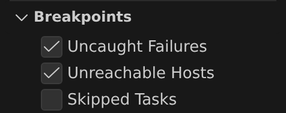
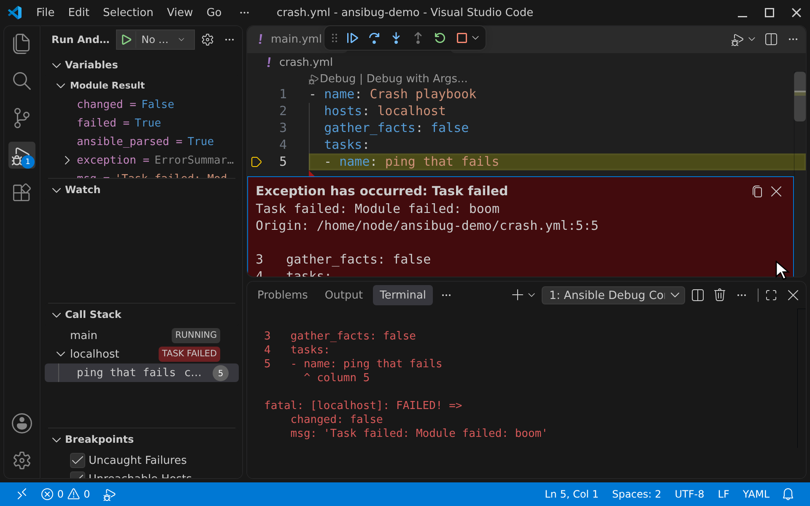

# Breakpoints
Ansibug supports the following types of breakpoints:

+ [Line Breakpoints](#line-breakpoints)
+ [Logpoints](#logpoints)
+ [Function Breakpoints](#function-breakpoints)
+ [Exception Breakpoints](#exception-breakpoints)
    + Uncaught Failures
    + Unreachable Hosts
    + Skipped Tasks

You can also use [Hit Conditions](#hit-conditions) on a line and function breakpoint to only stop on certain hits.

## Line Breakpoints
For a line breakpoint the first step to debugging a playbook is to place a breakpoint on the task you wish to stop at.

<video src="./images/set_breakpoint.mp4" poster="./images/set_breakpoint.png" width="960" height="600" autoplay loop muted playsinline controls preload="metadata"></video>

It is also possible to set a condition on the breakpoint so that it is only hit when the condition is tree.
The expression for a condition is treated as a template expression just like a `when` task condition.
For example to have the breakpoint only be hit when running on the host `MYSERVER` set the expression to `inventory_hostname == 'MYSERVER'`.

<video src="./images/set_conditional_breakpoint.mp4" poster="./images/set_conditional_breakpoint.png" width="960" height="600" autoplay loop muted playsinline controls preload="metadata"></video>

The expression will use the variables that are set at the time the breakpoint is set.
It is important not to use `{{ }}` in the expression as the value is already templated.
If the expression is an invalid template it will be treated as `False` and never be hit.

Part of the validation for breakpoints will update the client on the proper locations.
This will happen when the playbook starts if the task has already been loaded.
Otherwise for tasks dynamically loaded at runtime, with something like `include_tasks`, they will only be validated when they are loaded.

<video src="./images/breakpoint_relocation.mp4" poster="./images/breakpoint_relocation.png" width="960" height="600" autoplay loop muted playsinline controls preload="metadata"></video>

The breakpoints will always move to the first line of the previous task that is known to the debugger.

### Limitations
The following playbook/tasks entries cannot have a breakpoint set on them.

+ Play roles under `roles`

```yaml
- hosts: localhost
  roles:
  - role1
  - role2
```

+ `import_*` tasks

```yaml
- import_playbook: play.yml

- hosts: localhost
  tasks:
  - import_role:
      name: role1

  - import_tasks:
      file: tasks.yml
```

+ The `block`, `rescue`, and `always` lines in a block

```yaml
- block:  # Cannot set a breakpoint here
  - name: task 1
    ping:

  rescue:  # Will snapback to 'task 1'
  - name: task 2
    ping:

  always:  # Will snapback to 'task 2'
  - name: task 3
    ping:
```

Attempting to set a breakpoint on the `block` will be invalidated when the block is loaded.
Setting it on `rescue` or `always` will count as the previous task and will automatically be changed to the correct line when the block is loaded.

<video src="./images/block_breakpoints.mp4" poster="./images/block_breakpoints.png" width="960" height="600" autoplay loop muted playsinline controls preload="metadata"></video>

This is a limitation with the current breakpoint validation behavior as these entries are not seen by the debug code.
The only thing it can do is treat it as a line as part of the preceding task.

## Logpoints
A logpoint is a line breakpoint that writes a message to the Debug Console instead of stopping when hit.
To create a logpoint, right click the breakpoint margin and select `Add Logpoint...`.
The message you use for the logpoint is templated for each host that reaches the task, for example `{{ inventory_hostname }}: installing {{ packages | length }} packages`.

<video src="./images/logpoint.mp4" poster="./images/logpoint.png" width="960" height="600" autoplay loop muted playsinline controls preload="metadata"></video>

## Hit Conditions
A hit condition can be used with a line or function breakpoint to only stop on certain hits.
A hit is a counter for every host that reaches the task.
To set a hit condition, select `Hit Count` when adding a conditional breakpoint, or editing an existing one.
The condition can use one of these operators `==`, `>`, `>=`, `<`, `<=`, or `%` followed by a number.
It is also possible to use a number by itself which is the same as `==`.

|Condition|Stops on|
|-|-|
|`3`|The 3rd hit|
|`>=3`|Every hit from the 3rd|
|`%3`|Every 3rd hit|

In this example the playbook runs on `web1`, `web2`, and `db1` and the hit condition `2` only stops when `web2` reaches the task.

<video src="./images/hit_condition.mp4" poster="./images/hit_condition.png" width="960" height="600" autoplay loop muted playsinline controls preload="metadata"></video>

If both a condition and hit condition are set, only the hits where the condition is true are counted.

## Function Breakpoints
A function breakpoint can be used to stop on a that runs a specific module or task name without needing to set a line breakpoint.
To add a function breakpoint, use the `+` button in the `BREAKPOINTS` pane.
The value is a glob expression that is matched against the module as written in the task, the module it resolved to, and the task name.

|Function breakpoint|Stops on|
|-|-|
|`ansible.builtin.package`|Every task that runs the `ansible.builtin.package` module|
|`*.ping`|`ping` from any collection|
|`Install *`|Tasks named `Install ...`|
|`Restart [*]`|Only a task named `Restart *`, wrap a glob character in brackets to match it literally|

<video src="./images/function_breakpoint.mp4" poster="./images/function_breakpoint.png" width="960" height="600" autoplay loop muted playsinline controls preload="metadata"></video>

## Exception Breakpoints
By default `ansibug` will enable the `Uncaught Failures` and `Unreachable Hosts` breakpoint which will trigger when a task has failred or a host was marked as unreachable respectively.
It is also possible to enable the `Skipped Tasks` exception breakpoint which will trigger when a task was skipped based on the `is skipped` test.
Enabled or disabling these types of exception breakpoints is done through the `BREAKPOINTS` pane (typically in the bottom left hand section) of the debugger:

{ width="238" }

It is important to note that `Uncaught Failures` will not trigger when:

+ The `ignore_errors: true` directive is set on the task
+ The task is contained within a block with a `rescue` section
+ The task failed due to an unreachable host, this will trigger `Unreachable Hosts` instead

The `Unreachable Hosts` breakpoint will not trigger if the `ignore_unreachable: true` directory is set on the task.

When a breakpoint is hit, the UI will focus on the task that triggered the breakpoint and the variables pane will include a new scope called `Module Result` that contains the results of the task.
You can use this pane to get more information about the task and interest with it in the debug console.

{ width="960" }

While the UI will allow you to set the variables in this scope, it will not be persisted when the breakpoint continues.
To try a fix for the failed task, change its module options or variables and run it again with `Restart Frame`, see [Restarting a Failed Task](./stepping.md#restarting-a-failed-task).

It is also possible to set a condition on these exception breakpoints so they only stop on certain results.
To set a condition, right click the exception breakpoint in the `BREAKPOINTS` pane and select `Edit Condition...`.
The condition is an Ansible conditional, like `when`, with the task result available as `result`.
For example `inventory_hostname == 'db1'` only stops when `db1` fails and `'Permission denied' in result.msg` only stops on that error.

<video src="./images/exception_condition.mp4" poster="./images/exception_condition.png" width="960" height="600" autoplay loop muted playsinline controls preload="metadata"></video>
