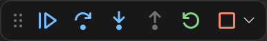
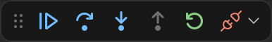

# Stepping
When a breakpoint is hit there are 4 options that are available.
Depending on the debug configuration type used, the following stepping panel will look like one of the following:

**Stop**

{ width="193" }

**Disconnect**

{ width="194" }

In order the options are:

+ Continue
    + Will continue the execution until the next breakpoint is hit
+ Step over
    + Will stop on the next task even without a breakpoint on it
+ Step in
    + For `include_*` tasks, will stop at the first task that is included
    + For any other tasks it acts like step over
+ Step out
    + Will step out on the parent stack frame
    + For example when run in a task inside an `include_*` tasks, a step out will break on the task after the `include_*`
+ Restart
    + Will stop the current process and re-launch it, this will only work for the Launch configuration and will fail with an Attach configuration
+ Stop (Default for Launch)
    + Will stop the executing `ansible-playbook` process that is being debugged
    + No more tasks/plays will be run and the debug session will be closed.
+ Disconnect (Default for Attach)
    + Will disconnect the debug session
    + The `ansible-process` will continue to run in the background

While the defaults for a launch and attach session is to stop or disconnect respectively, it is possible to choose the opposite by either holding down the alt key or selecting the other option in the drop down menu for that icon.

Currently `ansibug` does not support disconnect with suspend or a way to reattach to a disconnected session.
These features may be added in the future if there is demand for it.

You can use the stack frames on the host list to determine the current level the task is running under.
A step out will move back a frame and onto the next task after it.

When a playbook is run, each task on each host is considered a valid step to be checked for a breakpoint.
If a breakpoint is set on a task which will run for 2 hosts, the breakpoint will be hit for both.

<video src="./images/include_with_hosts.mp4" poster="./images/include_with_hosts.png" width="960" height="600" autoplay loop muted playsinline controls preload="metadata"></video>

In this example a play is running on `web1` and `web2` with a single breakpoint on a task inside an included file.
The first host will stop at the breakpoint with the stack and variables for that host shown.
When the execution is continued the breakpoint will then stop for `web2` at the same task.
To set a breakpoint only for a single or subset of hosts, use a conditional expression for the breakpoint on `inventory_hostname` or any other relevant hostvar.

## Pausing
The `Pause` button can be used to pause a running playbook.
The pause will be done at the next host to start a task stops before the task run.
It is not possible to interrupt a module that is already running so the pause may appear to have worked until that task is complete.
A message is shown in the `ansible-playbook` output when the pause is requested so it is clear it is waiting, pausing again before it stops has no extra effect.

<video src="./images/pause.mp4" poster="./images/pause.png" width="960" height="600" autoplay loop muted playsinline controls preload="metadata"></video>

## Restarting a Failed Task
When a task stops on a failed, unreachable, or skipped result, it can be run again with `Restart Frame` on the task in the `CALL STACK` pane.
This is like `redo` in Ansible's task debugger and it allows you to change a module option or variable first to try a fix without restarting the whole playbook.
Once a frame is restarted, the task will stop again before it re-runs so more changes can be made before it is started.

<video src="./images/restart_failed_task.mp4" poster="./images/restart_failed_task.png" width="960" height="600" autoplay loop muted playsinline controls preload="metadata"></video>

When a task is re-run, the display will show a new `TASK [name (restarted)]` header underneath the failed task output.
The header is not shown for plays using the `free` or `host_pinned` strategy, the result of the re-run is shown straight after the failed task output.
The result of the first run is still shown in the `ansible-playbook` output but is not counted in the play recap.
A loop task re-runs every item, and any change the first run made on the host is not undone.

## Static Imports

As `import_*` tasks are resolved statically before being seen by the debuggee they are not treated like `include_*` tasks.
Stepping out of a task added by `import_tasks` will not step out to the task after the `import_tasks`.
For example

```yaml
# main.yml
- name: task 1
  import_tasks:
    file: tasks.yml

- name: task 2
  ping:

# tasks.yml
- name: task 3  # Currently stopped here
  ping:
```

Stepping out of `task 3` will step out of the whole play because the `import_tasks` is not part of the known stack to the debugger.

## Loops
Task loops with `loop`, `with_*`, or `until` are treated as a single task, the breakpoint will fire before the task is run and will not hit during the loop iterations.
For example:

<video src="./images/loop_stepping.mp4" poster="./images/loop_stepping.png" width="960" height="600" autoplay loop muted playsinline controls preload="metadata"></video>

This is a limitation due to the ways are run in Ansible.
The strategy has no control over the loop iterations so it cannot pause during the iteration.
